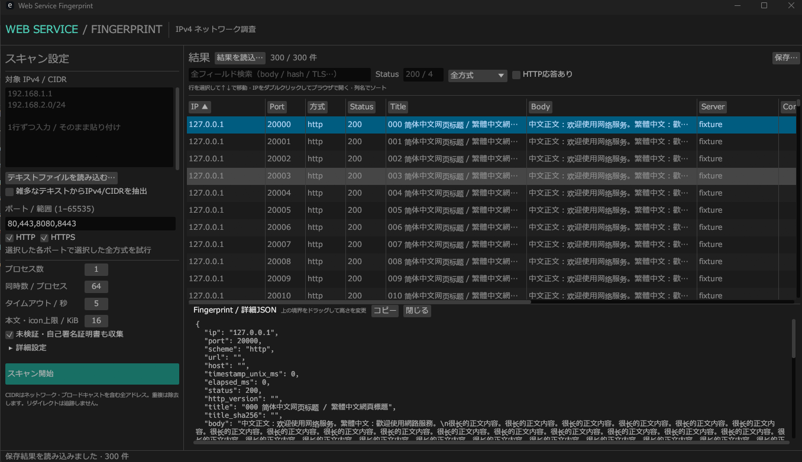

# Web Service Fingerprint

Rust製のWebサービス調査GUIです。egui/eframeのGUIとスキャン子プロセスを分離し、子プロセス内ではTokioのマルチスレッドランタイムで非同期通信します。Windowsでビルド・動作検証済みです。macOS/Linux向けのビルド手順も以下に記載していますが、このプロジェクトでのビルド・実機動作は未検証です。



*Windowsでの画面例。スクリーンショット内の結果は表示確認用のサンプルデータです。*

## 起動

ビルド済みの場合は `target/release/http-service-scan-gui.exe` を起動します。開発時は以下を実行します。

```powershell
cargo run --release --locked
```

Windows + Rust 1.94 / MSVC Build Toolsでビルド・検証。依存関係はCargo.lockで固定しています。WebViewやNode.jsは不要です。

## OS別のビルド

[build.ps1](build.ps1) はPowerShell用、[build.sh](build.sh) はmacOS/Linux等のPOSIXシェル用です。どのディレクトリから実行してもプロジェクトのルートへ移動し、`cargo build --locked --release --target <ターゲット>` を実行します。ターゲットを省略した場合は `rustc -vV` のホストを使用します。Rustターゲット・SDK・OSパッケージのインストール、アプリの起動、スキャンは行いません。

Rust/CargoをPATHに登録してください。以下の手順は検証環境と同じRust 1.94以降を想定しています。

| OS / CPU | ターゲット例 | このプロジェクトでの検証 |
| --- | --- | --- |
| Windows x64 | `x86_64-pc-windows-msvc` | ビルド・GUI動作を確認済み |
| macOS Apple Silicon | `aarch64-apple-darwin` | 未検証 |
| macOS Intel | `x86_64-apple-darwin` | 未検証 |
| Linux x64 | `x86_64-unknown-linux-gnu` | 未検証 |
| Linux ARM64 | `aarch64-unknown-linux-gnu` | 未検証 |

### Windows

Visual Studio Build Toolsの「C++によるデスクトップ開発」とWindows SDKを用意します。MSVC用のRustツールチェーンを使用してください。

```powershell
.\build.ps1

# ターゲット指定 / 開発ビルド / チェックのみ / オフライン
.\build.ps1 -Target x86_64-pc-windows-msvc
.\build.ps1 -Development
.\build.ps1 -Check -Offline
.\build.ps1 -Help

# ビルドしたGUIを起動
.\target\x86_64-pc-windows-msvc\release\http-service-scan-gui.exe
```

### macOS

Xcode Command Line ToolsとRustを用意し、macOS上でネイティブビルドします。

```sh
xcode-select --install  # 未導入の場合
sh build.sh

# Apple Silicon / Intelを明示する場合
sh build.sh --target aarch64-apple-darwin
sh build.sh --target x86_64-apple-darwin

# Apple Silicon版の起動例
./target/aarch64-apple-darwin/release/http-service-scan-gui
```

別CPU向けには先に対応するRustターゲットを導入してください。生成物は単体のMach-O実行ファイルです。`.app` バンドル、Universal Binary、署名、公証、DMG作成はスクリプトの対象外です。

現在のフォント読込はWindows用パスとLinuxのNoto CJK用パスのみで、macOSのシステムCJKフォントは自動検出しません。そのためmacOSでの日本語・中国語表示にはフォント読込処理の追加対応が必要です。ビルド成功とGUI表示品質は別途確認してください。

### Linux

この構成はX11/WaylandとOpenGL（glow）を使用します。Ubuntu/Debian系での依存パッケージ例です。ディストリビューションやデスクトップ環境に応じて調整してください。

```sh
sudo apt-get update
sudo apt-get install -y build-essential pkg-config \
  libx11-dev libxrandr-dev libxi-dev libxcursor-dev \
  libxkbcommon-dev libwayland-dev libgl1-mesa-dev fonts-noto-cjk

sh build.sh
./target/x86_64-unknown-linux-gnu/release/http-service-scan-gui

# その他のオプション
sh build.sh --development
sh build.sh --check --offline
sh build.sh --help
```

実行にはX11またはWaylandのGUIセッションと、OpenGLを利用可能なドライバーが必要です。ファイルダイアログはrfdの既定XDG Desktop Portalバックエンドを使用するため、セッションD-Busとデスクトップに合ったportalを用意してください。GTK系環境なら `xdg-desktop-portal` と `xdg-desktop-portal-gtk`、KDEなら対応するKDEバックエンドが対象です。SSHだけの環境ではGUIは表示できません。

日本語・中国語の表示には、コードが参照する `/usr/share/fonts/opentype/noto/NotoSansCJK-Regular.ttc` が配置されていることも確認してください。パッケージのフォント配置が異なる場合は読込パスの調整が必要です。

### 出力先とスクリプトのオプション

| 用途 | PowerShell | POSIXシェル |
| --- | --- | --- |
| Releaseビルド（既定） | `.\build.ps1` | `sh build.sh` |
| ターゲット指定 | `-Target <triple>` | `--target <triple>` |
| Debugビルド | `-Development` | `--development` |
| コンパイルチェックのみ | `-Check` | `--check` |
| ネットワークを使用しない | `-Offline` | `--offline` |
| ヘルプ | `-Help` | `--help` |

オプションは組み合わせ可能です。`--check` / `-Check` は実行ファイルを生成せず、リンク・GUI動作を検証しません。オフライン実行には依存クレートが事前取得済みである必要があります。

両スクリプトは常にターゲットを明示するため、既定の出力先は `target/<triple>/release/`、開発ビルドは `target/<triple>/debug/` です。Windowsではファイル名に `.exe` が付きます。`CARGO_TARGET_DIR` やCargo設定で出力先を変えた場合はその設定が優先されます。ターゲット指定なしで直接 `cargo build --release --locked` を使った場合は、通常 `target/release/` に出力されます。

## クロスコンパイル

異なるOS/CPU向けには、Rust標準ライブラリに加えて、そのターゲット用のリンカー、Cコンパイラー、SDK/sysroot、ネイティブライブラリが必要です。`rustup target add` だけではそれらは導入されません。このアプリにはring等のCビルドやGUI依存があるため、ターゲット指定だけで全OS向けにビルドできるものではありません。[rustupのクロスコンパイル説明](https://rust-lang.github.io/rustup/cross-compilation.html)

```sh
# 例: macOS上で別のmacOS CPU向けのRust標準ライブラリを導入
rustup target add aarch64-apple-darwin x86_64-apple-darwin
sh build.sh --target aarch64-apple-darwin
sh build.sh --target x86_64-apple-darwin
```

macOS向けにはAppleのSDKと適切なClang/リンカーが必要です。macOS上でのビルドを基本とし、Windows/LinuxからのmacOS向けビルド環境はこのスクリプトでは構築しません。[RustのmacOSターゲット要件](https://doc.rust-lang.org/rustc/platform-support/apple-darwin.html)

Linux x64からLinux ARM64 GNU向けにビルドする場合の設定例です。ARM64用のCツールチェーン・sysroot・必要なネイティブライブラリが事前に用意されている環境を想定しており、このプロジェクトでは未検証です。

```sh
rustup target add aarch64-unknown-linux-gnu
export CARGO_TARGET_AARCH64_UNKNOWN_LINUX_GNU_LINKER=aarch64-linux-gnu-gcc
export CC_aarch64_unknown_linux_gnu=aarch64-linux-gnu-gcc
sh build.sh --target aarch64-unknown-linux-gnu
```

必要に応じてターゲット側のpkg-config検索先も設定してください。ホスト側のライブラリを混ぜないことが重要です。リンカーは `.cargo/config.toml` の `[target.<triple>]` または環境変数で指定できます。[Cargoのターゲット設定](https://doc.rust-lang.org/cargo/reference/config.html#target)

Windows MSVC向けにはWindows SDKとMSVC互換のビルド環境が必要です。WindowsからLinux向けにはLinux用ツールチェーンが必要で、WSL2やLinux環境でLinux版をビルドする方法もあります。配布用にはWindows・macOS・LinuxそれぞれのマシンまたはCIランナーでネイティブビルドし、対象OSで起動・ファイルダイアログ・子プロセス起動・保存を確認する構成を推奨します。Linux GNU版は配布先のglibc/GUIライブラリとの互換性も確認してください。

参考: [eframeの対応プラットフォーム](https://github.com/emilk/egui/blob/0.31.1/README.md)、[rfdのLinuxバックエンド](https://docs.rs/rfd/0.15.4/rfd/#linux--bsd-backends)。

## 操作

1. 対象欄へIPv4/CIDRを貼り付けるか、UTF-8のテキストファイルを読み込みます。BOM付きファイルも対応。入力上限2 MiB。
2. 通常モードでは改行・空白・カンマ・セミコロンで区切れます。`#` 以降はコメント。雑多なログ等は「IPv4/CIDRを抽出」を選択します。不正な候補は抽出モードでは無視し、通常モードではエラー表示します。
3. ポートを `80`、`80,443,8080-8090`、`1-65535` の形式で入力します。
4. HTTP/HTTPS、プロセス数、同時数、タイムアウト、取得サイズを選んで開始。両方式を選ぶと全ポートで両方を試します。
5. Titleの右にBodyのプレビューを表示します。本文は幅で省略し、全文は行を選んだ際の詳細JSONで確認できます。行を選択後、↑↓キーで現在の表示順に移動し、選択行へ自動スクロールします。入力欄や詳細テキストを操作中はそのキー操作を優先します。表は常時表示の縦横スクロールバー・列幅変更に対応。詳細JSONは上側の境界をドラッグして高さを変えられます。
6. 「保存」から全件、または表示中の結果をCSV/JSONに保存。スキャン中でも保存時点のスナップショットを出力できます。「結果をクリア」で結果・詳細JSON・検索条件・進捗表示を空にできます（スキャン・ファイル処理中は無効）。スキャン設定は保持します。新しいスキャンは入力検証に成功してから以前の結果と検索条件をクリアし、新しい結果だけを表示します。
7. 表の「結果を読込」から、このアプリで保存したJSON/CSVを読み込めます。読込上限は512 MiB・10万件。正常に読めた場合に現在の表を置換し、検索・フィルタを解除します。古い保存ファイルの不足フィールドは初期値で補います。入力IPリストの読込とは別の操作です。
8. IPセルのダブルクリックで、その行の方式に従い `http://IP:port/` または `https://IP:port/` を既定のブラウザで開きます。Host/SNI指定があってもIPのURLを開きます。ブラウザ自身の証明書検証やネットワーク設定はそのまま適用されます。

全フィールド検索、ステータス前方一致（`4`なら4xx）、方式、HTTP応答の有無で絞り込めます。検索は各フィールドの値とレスポンスヘッダー名が対象で、フィールド名と本文のBase64は対象外です。初回検索時に検索用テキストを作成するため、その分のメモリを使用し、大量の結果では最初の検索に時間がかかる場合があります。列名クリックで昇順・降順ソート。

CIDRはネットワーク・ブロードキャストを含む全アドレスを対象とし、重複・重複CIDRを統合します。IPv6、ホスト名の入力リストは対象外。Host/SNIのドメイン名は詳細設定で指定でき、その場合も接続先IPは入力値に固定します。`127.1` のようにIPv4と解釈される値は指定できません。

抽出モードでは文末のピリオドを除いて認識します。URLのホスト部は `http://10.0.0.1/24` でもパスとして扱い、そのIPだけを対象にします。

## 収集するフィールド

| 種別 | 内容 |
| --- | --- |
| 接続 | IP、ポート、方式、URL、Host、取得開始Unixミリ秒、所要ミリ秒、エラー |
| HTTP | HTTPバージョン、ステータス、タイトル、Server、Content-Length、Content-Type、Location、全レスポンスヘッダー、複数Set-Cookie |
| 本文 | 表示用テキスト、元バイト列Base64、取得バイト数、SHA-256、切り詰めフラグ、文字コード、文字置換の有無 |
| Favicon | URL、ステータス、SHA-256、MMH3、取得エラー |
| TLS | ネゴシエートされたバージョン・cipher、subject、issuer、serial、SAN、有効期間、自己署名判定、葉証明書SHA-256、提示されたチェーン各証明書SHA-256、取得エラー |

### ハッシュ・取得の意味

- タイトルはHTMLパーサーで文字参照をデコードし、連続空白を単一スペースに正規化したUTF-8文字列のSHA-256です。タイトルなしの場合は空文字列のハッシュ。
- 本文SHA-256とBase64は、HTTPのtransfer framingを除いた**取得済みバイト列**が対象です。取得上限超過時は先頭部分のハッシュで、`body_truncated=true` と表の `+` で明示します。
- `Accept-Encoding: identity` を送り自動展開を無効化するため、元のContent-Length等を維持します。サーバーが圧縮を強制した場合は圧縮済みバイト列が記録され、本文表示・タイトル抽出はできない場合があります。
- 本文の文字コードはBOM、Content-Typeのcharset、先頭8 KiB内のHTML meta（charset / http-equiv）、UTF-8判定、統計的な自動判定の優先順で選びます。GB2312/GBK、GB18030、Big5も対応。自動判定は短い本文等で誤る可能性があります。選んだ文字コードと置換の有無を結果に記録し、元バイト列はBase64で保持します。Windowsでは日本語フォントに加えMicrosoft YaHei・JhengHei・SimSunを使用可能な範囲でフォールバックに登録します。過去に文字化けした文字列を保存した結果は、その内容を保持して読み込みます。新しい文字コード判定を適用するには再取得してください。
- FaviconはHTMLの `link rel="icon"`（`shortcut icon`を含む）を優先し、指定がなければ `/favicon.ico`。同一originのみ取得し、外部アイコンやリダイレクト先は追跡しません。取得エラー時や上限超過時のハッシュは空です。
- Favicon MMH3はMurmurHash3 x86_32 / seed 0 / signed i32。入力はアイコンのBase64を76文字でLF改行し末尾にもLFを付けたものです（一般的なShodan形式）。SHA-256は元アイコンバイト列。
- HTTPSの証明書・version/cipherは**HTTP取得とは別のTLS接続**で収集します。ロードバランサー等ではHTTP接続と提示証明書やネゴシエーションが異なる可能性があります。TLS能力の総当たりではなく、成功した1回のネゴシエーション情報です。rustlsが対応するTLS 1.2/1.3が対象です。
- `self_signed` はsubject/issuer一致に加えて自己署名の暗号学的検証が成功した場合のみtrueです。信頼済み・有効期限内という意味ではありません。
- 初期設定では自己署名/信頼されない証明書も観測します。「未検証・自己署名証明書も収集」を外すと公開ルートストアとホスト名/IPによる検証を行います。Cookieは記録のみで再送しません。
- リダイレクトを追わずLocationを記録します。プロキシ環境変数を使用しません。WebコンテンツのJavaScriptは実行しません。

## 並列処理・上限・停止

最大8子プロセス、それぞれ1〜1024同時プローブ、各子プロセスに2本のTokio実行スレッド。総同時プローブ数は `プロセス数 × 同時数` です。各プローブ内ではroot、favicon、TLSメタデータの通信を順番に行います。タイムアウトは各HTTP要求/TLS取得ごとで、行全体ではその数倍になる場合があります。

ジョブは遅延生成し、結果通信は128件の有界チャネルで制限。GUIは表示行のみを描画し、ファイル読み書きとスキャンはGUIスレッド外で処理します。停止は子プロセスを終了し、到着済みの結果を保持。GUIを閉じる際も子プロセス終了を待ちます。

初期上限は10万プローブ・1万保持行、本文/icon各16 KiBです。詳細設定で変更できます。保持上限到達時は停止し、完了扱いにはしません。停止後に配送中の結果が受信されることがあるため、受信数と保持数は異なる場合があります。大規模調査は対象を分割して保存してください。本文・Base64・結果の検索にはメモリとCPUを使用します。高負荷時の性能は環境依存で、スループットを保証するものではありません。

CSVはUTF-8 BOM付きで、配列・オブジェクトをJSON文字列として各セルに格納します。表計算ソフトで数式と解釈される文字列は先頭に `'` を付加し、`__csv_escaped_fields` 列へ対象フィールド名を記録して再読込時に元に戻します。古いCSVではこの付加を推定して戻すため、元から `'=` 等で始まる文字列と曖昧になる場合があります。厳密な保持にはJSONまたは新形式のCSVを使用してください。保存は同じディレクトリの一時ファイルへ書いた後に置換します。

## 開発・検証

```powershell
cargo fmt --check
cargo clippy --locked --all-targets -- -D warnings
cargo test --locked
cargo build --release --locked
python tests/smoke_worker.py target/release/http-service-scan-gui.exe
```

テストはlocalhostだけを使用。入力境界・重複除去、ハッシュ既知値、HTTP応答、複数Cookie、favicon、サイズ上限、リダイレクト、Host固定、自己署名証明書・厳格検証、CSV/JSONを検証します。ソケット禁止のサンドボックスではHTTP/TLSテストは実行できません。

Pythonのスモークテストは標準ライブラリだけで動き、2つの子プロセスのジョブ分担と取得値を確認します。GUIを手動確認する場合は `python tests/smoke_worker.py --serve` で表示されたlocalhostポートを入力できます。`--delay 30` を追加すると停止操作を確認できます。

参照API: [eframe](https://docs.rs/eframe/0.31.1/eframe/)、[Tokio Rustls](https://docs.rs/tokio-rustls/0.26.6/tokio_rustls/)、[X.509 parser](https://docs.rs/x509-parser/0.17.0/x509_parser/)。
